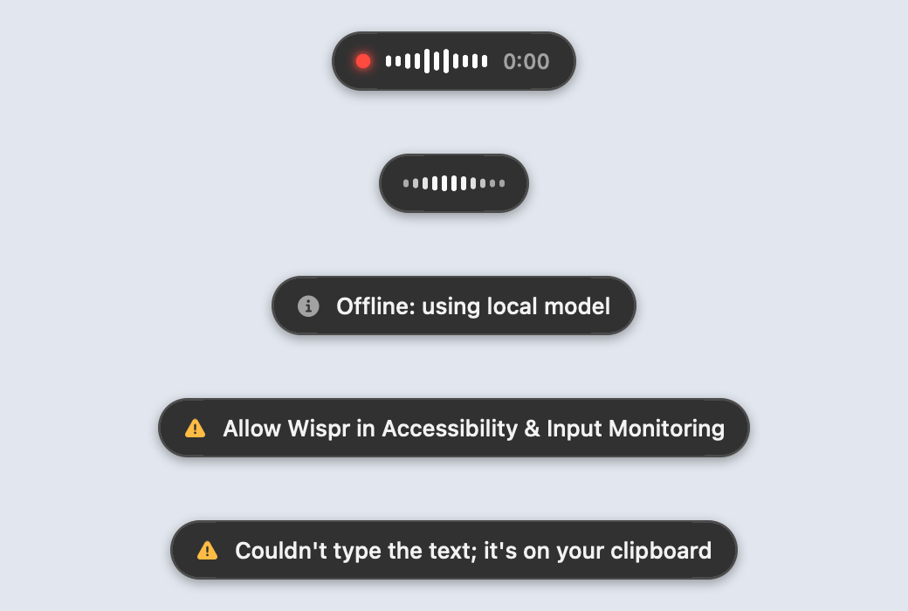

<h1 align="center">Wispr</h1>

<p align="center">
  <b>Tap <code>Fn</code>, speak, and clean text appears wherever you're typing.</b><br>
  A fast, private, open-source take on Wispr Flow for macOS, written in Rust.
</p>

<p align="center">
  
  
  
  
</p>

<p align="center">
  
</p>

---

## Contents

- [Why Wispr](#why-wispr)
- [Requirements](#requirements)
- [Install](#install)
- [Usage](#usage)
- [Running in the background](#running-in-the-background)
- [How it works](#how-it-works)
- [Offline and failure handling](#offline-and-failure-handling)
- [History in Obsidian](#history-in-obsidian)
- [Configuration](#configuration)
- [Command-line reference](#command-line-reference)
- [Performance](#performance)
- [Privacy](#privacy)
- [Troubleshooting](#troubleshooting)
- [Development](#development)
- [Contributing](#contributing)
- [Uninstall](#uninstall)
- [License and acknowledgments](#license-and-acknowledgments)

---

## Why Wispr

- **Fast.** About 0.4 s from the moment you stop talking to text on screen. Audio streams to
  Deepgram *while* you speak, so the transcript is nearly done when you finish.
- **Works offline.** If the internet or Deepgram is down, Whisper runs on your Mac's GPU
  and takes over with the same audio. A dictation is never lost.
- **Clean text.** It drops "um" and "uh", and resolves self-corrections
  ("four, no actually five" becomes "five"). It also fixes the words you teach it and
  formats per app.
- **Never answers back.** Clean-up is plain rules, not an AI model. It types what you said, and a
  question stays a question.
- **Stays out of the way.** No Dock icon and no window, and it never takes focus. It uses 0% CPU
  when idle, and the mic is on only while you dictate.
- **History in Obsidian.** Your last 50 dictations live in a note, each with its own Copy button.

## Requirements

| Need | Notes |
|---|---|
| macOS 13 or later on Apple Silicon | Whisper runs on the GPU through Metal |
| [Rust](https://rustup.rs) (stable, 2024 edition) | Builds the daemon |
| Xcode command line tools | `xcode-select --install`. Provides `swiftc` for the on-screen indicator |
| CMake | `brew install cmake`. Builds whisper.cpp |
| Deepgram API key *(optional)* | For the fast cloud engine. New accounts get $200 of free credit. Without a key, Wispr runs fully local |

## Install

```bash
git clone <this repo> && cd wispr
cp .env.example .env                        # optional: DEEPGRAM_API_KEY=...
cargo run --release -- --download-models    # offline Whisper model, 190 MB
scripts/wisprctl install --raycast-dir ~/path/to/raycast/scripts
```

`wisprctl install` builds **Wispr.app** into `~/Applications`, then registers it to start now and
at every login. It also copies your key and model, and adds the Raycast commands. Leave out
`--raycast-dir` if you don't use Raycast.

**1. Allow two permissions** when macOS asks, or in System Settings → Privacy & Security:

| Permission | Why |
|---|---|
| **Accessibility** | Lets Wispr paste or type into the focused app |
| **Input Monitoring** | Lets Wispr see the `Fn` key system-wide |
| **Microphone** | Asked on your first dictation |

Wispr restarts itself once Accessibility and Input Monitoring are both on.

**2. Change one keyboard setting:** System Settings → Keyboard → *Press 🌐 key to* →
**Do Nothing**. Otherwise macOS also opens the emoji picker or its own dictation.

**3. Check it:** run `wisprctl status` or Raycast's *Wispr Status*. You should see
`Wispr: running` and `ready: Fn ...`.

## Usage

| Do this | Result |
|---|---|
| Tap `Fn`, speak, tap `Fn` again | The text is typed where your cursor is |
| `Esc` while speaking or transcribing | Cancels the dictation. The key still reaches your app |
| `Fn` + another key (Fn+Delete, Fn+←) | Treated as a shortcut, not a dictation |

Prefer push-to-talk? Set `mode = "hold"`. Then you hold `Fn` to talk and release it to insert.

### The on-screen indicator

A small frosted pill sits above the Dock. It never takes focus and ignores the mouse.

| State | What you see |
|---|---|
| Listening | Red recording dot, a waveform that follows your voice, and the elapsed time |
| Transcribing | The pill shrinks to the bars, which ripple until the text arrives |
| Info | Gray ⓘ and a short message, for example "Offline: using local model" (2.5 s) |
| Problem | Amber ⚠ and what to do, for example "Microphone is silent: check permissions" (4 s) |

The pill respects *Reduce motion*. Turn it off with `--no-hud`.

## Running in the background

Wispr runs as a per-user launchd agent (`local.wispr.dictation`). It has no Dock or menu-bar
icon. You control it with `wisprctl` or Raycast.

| Command | Raycast | What it does |
|---|---|---|
| `wisprctl start` | *Start Wispr* | Starts it now |
| `wisprctl stop` | *Stop Wispr* | Stops it until you start it again or log in again |
| `wisprctl restart` | | Stop, then start (use this after editing the config) |
| `wisprctl toggle` | | Start if stopped, stop if running |
| `wisprctl status` | *Wispr Status* | Shows running state, memory, engine, last dictation, and recent problems |
| `wisprctl logs [-f]` | | Shows (or follows) `~/Library/Logs/wispr.log` |
| `wisprctl config` | | Opens the live config file |
| `wisprctl permissions` | | Opens the two Privacy panes Wispr needs |
| `wisprctl uninstall [--purge]` | | Removes the app and the login item (see [Uninstall](#uninstall)) |

- **At login:** Wispr starts by itself. You don't need Raycast for this.
- **After a crash:** launchd restarts it. A clean exit or a config error does not trigger a
  restart loop.

`wisprctl` installs itself to `~/Library/Application Support/wispr/wisprctl`. To type just
`wisprctl`, add this alias to `~/.zshrc`:

```bash
alias wisprctl="$HOME/Library/Application\ Support/wispr/wisprctl"
```

## How it works

```
 Fn key ─▶ microphone ─▶ 16 kHz audio (kept in RAM) ─┬─▶ Deepgram (cloud, streams while you talk)
                                                      │
                                                      └─▶ Whisper (on your Mac, if cloud fails)
                                                                   │
                                     text ◀───────────────────────┘
                                       │
              clean up: remove fillers, fix self-corrections, your vocabulary, app style
                                       │
                         paste into the focused app (your clipboard is restored)
                                       │
                         add to the history note in Obsidian
```

1. **Hotkey.** Wispr listens for `Fn` system-wide. `Fn` combined with another key counts as a
   shortcut, so it doesn't start a dictation.
2. **Microphone.** The mic is prepared at startup, so recording begins within about 50 ms. It
   records only while you dictate, so the macOS mic indicator is off the rest of the time.
3. **Speech to text.** Audio streams to **Deepgram** (`nova-3`) as you talk. At startup Wispr
   probes the US and EU endpoints and picks the faster one. A copy of the audio stays in memory
   for the offline fallback.
4. **Clean-up.** Deterministic rules, no AI model, so your words are never rewritten or answered:
   - Fillers are removed: "um, so let's go" becomes "So let's go".
   - Corrections are resolved: "port 8080, wait no, port 3000" becomes "port 3000". The same
     works with "scratch that" and "I mean".
   - Your vocabulary is fixed: "cube netties" becomes "Kubernetes".
   - Each app gets its own style. Terminals and one-line chat messages get no trailing period,
     and terminals get no trailing space.
5. **Typing.** Wispr saves your clipboard, pastes the text, and restores the clipboard, including
   images and files. In a password field (secure input) it types nothing and leaves the text
   on the clipboard.
6. **History.** The text is added to your Obsidian note on a background thread.

The control loop is a single thread that owns all state. The CoreAudio callback hands samples
over through a lock-free ring buffer. The states are
`Idle → Listening → Processing → Injecting` ([`src/pipeline.rs`](src/pipeline.rs)), and they are
unit-tested on their own.

## Offline and failure handling

Wispr keeps your recording in memory until it is text, so **a dictation is never lost**. When
Deepgram can't be used, the same audio goes to **Whisper**, which runs on your Mac's GPU.

| Situation | What Wispr does |
|---|---|
| Deepgram still connecting when you stop talking | Sends the audio to Whisper straight away, without waiting for round trips |
| Final transcript slower than `finalize_timeout_ms` (1.5 s) | Transcribes the same audio locally |
| Network or Deepgram error | Turns on offline mode for 30 s. The time doubles on each failure, up to 5 min |
| Deepgram rejects the API key | Offline mode for an hour, and the pill says so |
| Offline period ends | The next dictation tries Deepgram again by itself |

With `engine = "local"`, Wispr never sends audio off your Mac at all.

## History in Obsidian

```toml
[history]
path = "~/Documents/MyVault/Wispr Dictations.md"
max_entries = 50
open_obsidian = true
```

- Newest entries come first. Each one shows the time, the app, and `offline` if Whisper was used.
- **Each dictation is its own code block, so Obsidian shows a Copy button on every entry.**
- After 50 entries, the oldest is removed.
- If Obsidian isn't running when Wispr starts, Wispr opens it **in the background** on this note.

The note is a plain file, so no plugin is needed: Obsidian picks up file changes instantly. Wispr
writes it on a separate thread, so writing never slows down typing. It replaces the file in one
atomic step, so Obsidian never sees a half-written note. A small CSS snippet
(`.obsidian/snippets/wispr-history.css`) wraps long dictations, and only on this note.

## Configuration

The live config is `~/Library/Application Support/wispr/config.toml`. Edit it with
`wisprctl config`, then run `wisprctl restart`. Every option is documented in
[`config.example.toml`](config.example.toml). Every setting is optional.

| Setting | What it does | Default |
|---|---|---|
| `hotkey.key` | `Fn`, `RightOption`, `RightCommand`, `RightControl`, `RightShift`, `LeftOption`, `CapsLock`, `F1`–`F12` | `Fn` |
| `hotkey.mode` | `toggle` (tap to start and stop) or `hold` (push-to-talk) | `toggle` |
| `hotkey.cancel_key` | Cancels the current dictation | `Escape` |
| `transcription.engine` | `auto`, `deepgram`, or `local` (audio never leaves your Mac) | `auto` |
| `transcription.max_recording_seconds` | Stops and transcribes after this long | `300` |
| `deepgram.region` | `auto`, `us`, `eu` (audio processed in the EU) | `auto` |
| `deepgram.finalize_timeout_ms` | Longest wait for Deepgram before using Whisper | `1500` |
| `deepgram.spoken_punctuation` | Turns spoken "comma" and "new paragraph" into punctuation | `false` |
| `local.model_path` | Whisper model file | `models/ggml-small.en-q5_1.bin` |
| `local.fallback` | Keeps Whisper loaded for offline use (about 250 MB of memory) | `true` |
| `audio.device` | Input device name from `wispr --list-devices`. Empty means the system default | `""` |
| `audio.keep_warm_seconds` | Keeps the mic open after a dictation, for an instant next start | `0` |
| `output.method` | `paste` (fast) or `type` (never touches the clipboard) | `paste` |
| `output.trailing_space` | Adds a space between consecutive dictations (not in terminals) | `true` |
| `output.resolve_corrections` | Applies "no actually", "wait no", "scratch that" | `true` |
| `output.casual_chat` | Drops the trailing period in Slack, Discord, Messages | `true` |
| `history.path` | Obsidian note for your history. Empty turns it off | `""` |
| `[vocabulary]` | Canonical spelling and what gets misheard. Also boosts Deepgram recognition | — |

```toml
[vocabulary]
"Kubernetes" = ["cube netties", "cube nettys"]
"PostgreSQL" = ["postgres q l", "post gres"]
```

The Deepgram key is never stored in the config. It goes in
`~/Library/Application Support/wispr/.env` as `DEEPGRAM_API_KEY=...`, and `wisprctl install`
sets that file to mode `600`.

## Command-line reference

```
wispr [--config <path>] [COMMAND]
```

| Command | What it does |
|---|---|
| *(none)* | Runs the dictation daemon |
| `--check-hardware` | Checks the system, microphone, permissions, and engines |
| `--list-devices` | Lists audio input devices |
| `--download-models [NAME]` | Downloads a Whisper model: `small.en` (default), `base.en`, or `large-v3-turbo` |
| `--benchmark` | Measures end-to-end latency with synthetic speech |
| `--transcribe <file.wav>` | Prints the raw and formatted text for a WAV file |

| Option | What it does |
|---|---|
| `--config <path>` | Uses this config file (default: `./config.toml`, then the Application Support one) |
| `--no-hud` | Hides the on-screen indicator |
| `--dry-run` | Logs transcripts instead of typing them into apps |

| Environment variable | What it does |
|---|---|
| `DEEPGRAM_API_KEY` | Turns on Deepgram streaming. Also read from `.env` |
| `WISPR_LOG_TEXT=1` | Includes dictated text in logs (release builds redact it by default) |

## Performance

Measured on a MacBook Air M3:

| Step | Time |
|---|---|
| Press `Fn` → microphone recording | ~50 ms |
| Connect to Deepgram | ~0.7 s, while you are still talking |
| Stop → text from Deepgram | ~0.3–0.4 s |
| Stop → text from Whisper (offline) | ~0.8 s |
| Clean-up + paste | ~12 ms |
| Idle CPU | 0% |

Measure your own machine with `wispr --benchmark`. Each dictation's timings are also logged, for
example `release->text 310 ms (transcribe 214 ms, ...)`.

## Privacy

- Audio is kept **only in memory**. It is cleared at the start of each recording and never
  written to disk.
- With `engine = "local"`, audio never leaves your Mac. Otherwise it streams to Deepgram while
  you speak.
- Logs never contain what you said, only its length, unless you set `WISPR_LOG_TEXT=1`.
- Dictated text is stored on disk only if you turn on the history note.
- The on-screen indicator runs as a separate process. It never sees your text, only fixed
  status messages and the mic's loudness level.

## Troubleshooting

| Problem | Fix |
|---|---|
| Nothing happens when I press `Fn` | Run *Wispr Status*. Usually Accessibility or Input Monitoring is off. Run `wisprctl permissions` |
| The emoji picker opens with `Fn` | Keyboard → *Press 🌐 key to* → Do Nothing |
| "Microphone is silent: check permissions" | Allow Wispr under Privacy & Security → Microphone |
| "Offline: using local model" | The internet or Deepgram is down. Wispr switches back by itself |
| A word is always misheard | Add it to `[vocabulary]` |
| Permissions are asked again after an update | Expected: a new build is a new binary to macOS. Allow it again. If Wispr is listed but doesn't respond, remove it with `−` and add `~/Applications/Wispr.app` back |
| `wispr is already running` | Another copy is still running. Run `wisprctl stop`. If `pgrep -fl Wispr.app` still shows a copy, end it with `kill <pid>` |
| Text goes to the clipboard instead of being typed | A password field had focus (secure input). Paste it yourself with ⌘V |

Logs: `wisprctl logs -f`. Full self-check: `wispr --check-hardware`.

## Development

```bash
cargo build --release          # also compiles the Swift overlay (needs swiftc)
cargo test                     # 74 tests
cargo clippy --all-targets     # keep it at zero warnings
cargo fmt

target/release/wispr --dry-run                                  # log text instead of typing
WISPR_DEEPGRAM_HOST=offline.invalid target/release/wispr --dry-run   # simulate being offline
scripts/e2e/run.sh             # end-to-end: real Fn events, real engines, real paste
scripts/wisprctl install       # ship your build to the background service
```

The end-to-end suite speaks with `say` (fed in through `WISPR_TEST_AUDIO` instead of the mic).
It posts real HID key events and checks the text that lands in a small sink app. The terminal
needs Accessibility and Input Monitoring for this. The background service is paused while the
suite runs.

### Project layout

| Path | What it does |
|---|---|
| `src/main.rs` | CLI, startup, single-instance lock, restart after permissions are granted |
| `src/daemon.rs` | Main loop: records, picks Deepgram or Whisper, types the result |
| `src/pipeline.rs` | The state machine: Idle → Listening → Processing → Injecting |
| `src/hotkey.rs` | `Fn` detection and the Fn-shortcut cancel |
| `src/audio/` | Microphone (lock-free ring), resampling to 16 kHz, WAV reading |
| `src/vad.rs` | Silence and muted-mic detection |
| `src/asr/deepgram.rs` | Deepgram streaming client |
| `src/asr/breaker.rs` | Offline mode (circuit breaker) |
| `src/asr/whisper.rs` | Local Whisper on the GPU |
| `src/text.rs` | Clean-up rules |
| `src/context.rs` | Detects the target app and its kind (terminal, chat, …). Reads no window titles |
| `src/inject.rs` | Paste and clipboard restore, secure-input handling |
| `src/history.rs`, `src/obsidian.rs` | The Obsidian history note |
| `src/hud.rs`, `macos/overlay.swift` | The on-screen pill and its stdin protocol |
| `scripts/wisprctl`, `raycast/` | Background service and Raycast commands |
| `scripts/e2e/` | End-to-end test harness |

### Overlay protocol

`wispr-overlay` is a separate Swift process. Wispr drives it with one command per line on stdin:

| Command | Effect |
|---|---|
| `listening` | Shows the dot, the waveform, and the timer |
| `level <rms>` | Microphone loudness. Sent about 30 times a second while listening |
| `processing` | Shows the ripple animation |
| `notice <text>` | Info message, hidden after 2.5 s |
| `alert <text>` | Problem message, hidden after 4 s |
| `hide` | Fades out |

The overlay exits when its stdin closes. If it is missing or crashes, Wispr carries on without it.

## Contributing

Issues and pull requests are welcome. Before you open a PR:

1. `cargo fmt`, `cargo clippy --all-targets` with zero warnings, and `cargo test` all pass.
2. Behavior changes come with a test. State changes belong in `tests/pipeline_state.rs`, and
   clean-up rules belong next to `src/text.rs`.
3. For anything that touches typing, hotkeys, or audio, run `scripts/e2e/run.sh` too.
4. Keep the privacy guarantees: never write audio to disk, never log dictated text by default,
   and never send text to the overlay.
5. Keep the hot path fast. Measure with `wispr --benchmark` before and after.

When you report a bug, include `wisprctl status`, the output of `wispr --check-hardware`, and the
relevant lines from `wisprctl logs`. Release logs never contain your dictated text.

## Uninstall

```bash
wisprctl uninstall           # removes Wispr.app and the login item, keeps config, key, models
wisprctl uninstall --purge   # also deletes ~/Library/Application Support/wispr
```

Your Obsidian history note is never deleted.

## License and acknowledgments

MIT, as declared in [`Cargo.toml`](Cargo.toml).

Built on [whisper.cpp](https://github.com/ggerganov/whisper.cpp) (via
[whisper-rs](https://github.com/tazz4843/whisper-rs)), [Deepgram](https://deepgram.com),
[cpal](https://github.com/RustAudio/cpal), [ringbuf](https://github.com/agerasev/ringbuf),
[rdev](https://github.com/Narsil/rdev), [enigo](https://github.com/enigo-rs/enigo), and
[objc2](https://github.com/madsmtm/objc2). Inspired by Wispr Flow. This project is not affiliated
with Wispr Flow.
